

 

 

 

 
 
 

<table>
<tr>
<td width="50%"><a href="https://github.com/apache/incubator-resilientdb"></a></td>
<td width="50%"></td>
</tr>
<tr>
<td width="50%"></td>
<td width="50%"></td>
</tr>
</table>
 

 

 

 

  

 

 

 

 

 
